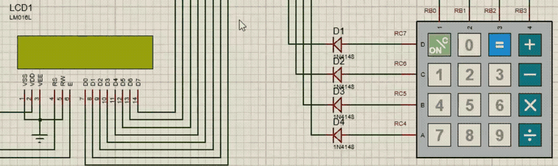
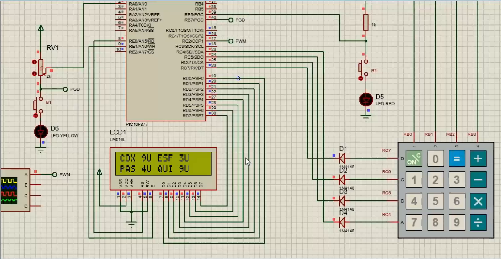

# Caixa de padaria com PIC16F877 em Assembly

Simulação de um caixa de padaria feita em **Assembly para o microcontrolador PIC16F877**, com display LCD, teclado matricial, memória EEPROM, conversor A/D e PWM. Foi o projeto final da disciplina de Microcontroladores, do curso de Engenharia Eletrônica da UTFPR, em 2021, e foi testado em simulação no **Proteus**.

> **English:** final project for the Microcontrollers course (UTFPR, 2021). A bakery checkout written in PIC16F877 assembly, using a 16x2 LCD, a 4x4 matrix keypad, internal EEPROM, the A/D converter and PWM, simulated in Proteus.

## Como funciona

O cliente escolhe o salgado em uma tecla de operação do teclado, digita a quantidade e aperta **=** para ver o valor a pagar.

| Tecla | Salgado | Preço |
|---|---|---|
| **+** | Coxinha | R$ 1 |
| **−** | Esfirra | R$ 3 |
| **×** | Pastel | R$ 2 |
| **÷** | Quibe | R$ 1 |

1. **ON/C** liga o caixa, e o display mostra `SALGADO:`.
2. A tecla do salgado escreve o nome dele, e o display pede `QUANTOS:`.
3. Depois de digitar a quantidade, a tecla **=** mostra `PAGAMENTO:` com o valor, que também é gravado na **EEPROM**.
4. O botão **B1** lê a EEPROM e mostra de novo o último pagamento.
5. O botão **B2** mostra a quantidade disponível de cada salgado e depois a tabela de preços.
6. Um **potenciômetro** é lido pelo conversor A/D, e o valor convertido define o ciclo de trabalho do **PWM**, que pode ser visto no osciloscópio da simulação.

## Circuito

- **PIC16F877** com cristal (oscilador XT)
- **LCD 16x2** (LM016L) em modo de 8 bits, ligado ao PORTD, com RS e E no PORTE
- **Teclado matricial 4x4**, com linhas no PORTC e colunas no PORTB, lido por varredura
- **Botões B1 e B2** no PORTB, cada um com um LED
- **Potenciômetro** na entrada analógica RA0
- **Saída PWM** no pino CCP1, ligada a um osciloscópio virtual

## Recursos do microcontrolador usados

| Recurso | Uso no projeto |
|---|---|
| GPIO | Varredura do teclado, botões e controle do LCD |
| EEPROM interna | Grava e lê o último pagamento, com troca entre os bancos de memória |
| Conversor A/D | Leitura do potenciômetro |
| CCP em modo PWM e Timer2 | Gera o sinal PWM a partir do valor convertido |
| Interrupção | Rotina de tratamento do fim da conversão A/D, com salvamento de W e STATUS |
| Endereçamento indireto | Limpeza da RAM na inicialização, com FSR e INDF |
| Macros | Seleção dos bancos de memória (BANK0 a BANK3) |

## Como montar e simular

**Ferramentas.** MPLAB IDE 8 com o montador MPASM, ou MPLAB X até a versão 5.35, e Proteus 8.

1. Abra o `padaria.asm` no MPLAB, selecione o PIC16F877 e monte o projeto. Se preferir, use direto o `padaria.hex`, que é o firmware já montado.
2. Abra o `padaria.pdsprj` no Proteus.
3. Dê dois cliques no PIC16F877 e, em *Program File*, selecione o arquivo `padaria.hex`.
4. Inicie a simulação e use o teclado virtual.

## O que eu faria diferente hoje

O código está como foi entregue em 2021, só com a codificação de texto convertida para UTF-8, para os acentos dos comentários aparecerem certos. Olhando com a experiência de hoje, eu mudaria estes pontos.

- **Valores de mais de um dígito.** A quantidade tem um dígito só, e o pagamento é mostrado como um único caractere. Valores acima de 9 aparecem errados. Eu converteria o resultado para decimal (BCD) antes de mostrar.
- **Preços apagados depois do primeiro pedido.** A multiplicação, feita por somas sucessivas, decrementa o próprio registrador do preço. Um segundo pedido do mesmo salgado, sem reiniciar o PIC, sai com valor errado. Eu usaria uma cópia temporária do preço.
- **Interrupção não habilitada.** A rotina de interrupção do A/D existe, mas o bit ADIE nunca é ativado, então a leitura acaba sendo feita por consulta no laço principal.
- **Mensagens letra por letra.** Cada texto do LCD é enviado com uma instrução por caractere, o que gera centenas de linhas repetidas. Eu usaria uma tabela com `retlw`.
- **Atrasos por laço de espera.** Os delays prendem o processador. Eu usaria um timer.
- **Brilho do LED.** A ideia era variar o brilho com o potenciômetro, mas isso não funcionou no simulador, como registrei nos comentários do código.

---

Desenvolvido por **Isadora Fernanda Zappe Schmidt** · [LinkedIn](https://www.linkedin.com/in/isadora-fernanda)
